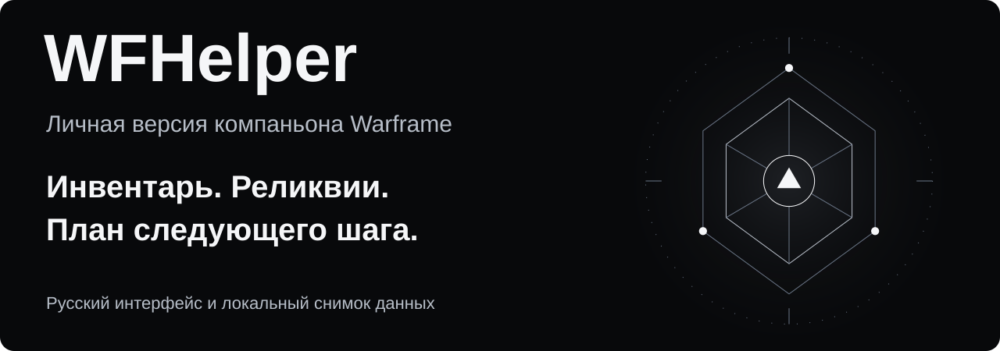
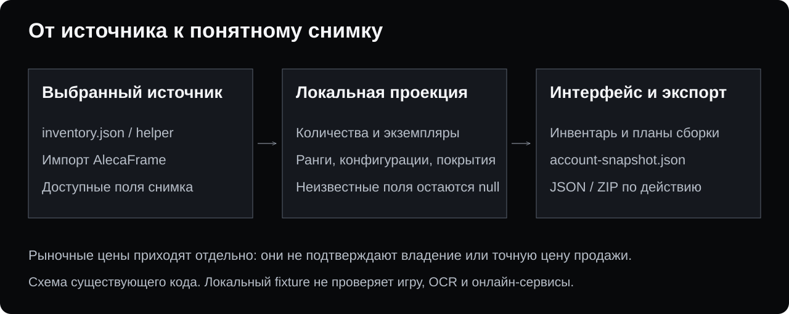
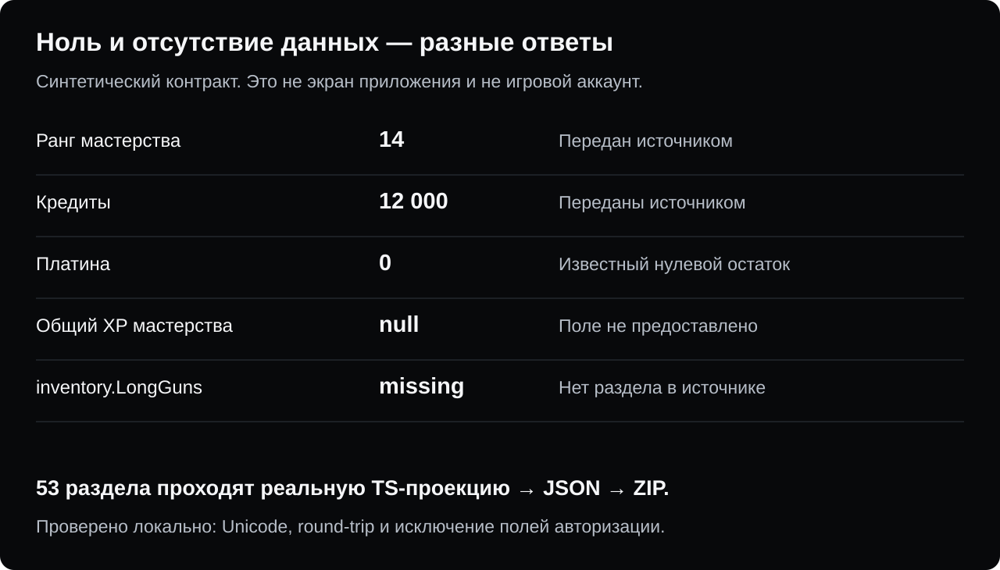

<picture>
  <source media="(max-width: 600px)" srcset="docs/readme/hero-mobile.svg">
  
</picture>

# WFHelper · личная версия

Компаньон Warframe для тех, кто хочет видеть, **что уже есть, что стоит оставить и чего не хватает для следующей сборки**. Инвентарь, реликвии, Кузница, мастерство и рыночные данные собраны в одном desktop-клиенте. Русский интерфейс и локальный снимок помогают разобраться в аккаунте без ручного переписывания таблиц.

**[Скачать Windows preview 0.3.0-preview.3](https://github.com/MikhailMostWanted/WFHelper/releases/tag/v0.3.0-preview.3)** · [Что проверено](#verification) · [Сборка из исходников](#build)

Сейчас собственный установщик исторически называется **WantedFrame**. Окончательное новое имя не утверждено. Репозиторий остаётся публичным форком [WFHelper/WFHelper](https://github.com/WFHelper/WFHelper); самостоятельные доработки находятся в `feat/wantedframe-next`. Их происхождение сохранено, отделение от сети форков ещё не выполнено.

[Возможности](#features) · [Моя версия](#own-version) · [Установка](#install) · [Сценарии](#journeys) · [Данные](#snapshot) · [Проверки](#verification) · [Происхождение](#origin)

<a id="features"></a>

## От инвентаря к следующему действию

| Задача | Что есть в клиенте |
| --- | --- |
| Разобрать накопленное | Инвентарь по категориям, количества, экземпляры снаряжения, фильтры и оценка торгуемых предметов. |
| Выбрать реликвию | Принадлежащие реликвии, состав наград, источники и экранный планировщик. |
| Подготовить сборку | Кузница с деревьями компонентов и мастерство с ещё не освоенным снаряжением. |
| Сравнить мод Разлома | Сохранённые моды и разбор характеристик; native OCR требует проверки на целевой Windows-системе. |
| Свериться с рынком | Цены и заявки warframe.market; личные заявки требуют отдельного входа и явного действия пользователя. |
| Следить за событиями | Мировые циклы, разломы, вторжения и арбитражи; разбор арбитражей использует `EE.log`. |

Рыночная оценка — ориентир по доступным ценам. Она не гарантирует продажу и не доказывает наличие предмета: владение определяется выбранным снимком инвентаря.

<a id="own-version"></a>

## Что добавлено в этой версии

Собственная preview-ветка развивает существующий клиент, сохраняя его инвентарь, рыночную сессию и пользовательские данные.

- **Русский UI и названия предметов.** Язык приложения выбирается отдельно от языка игры. В коде есть русский разбор наград реликвий и характеристик модов Разлома.
- **Подготовка справочника без ожидания пустого результата.** Окно создаётся до тяжёлой загрузки каталога; ранние запросы ждут готовности данных.
- **Ограниченная очередь OCR.** Таймаут ожидания не считается остановкой уже выполняющегося native-кода; после русского таймаута не запускается дополнительная английская попытка.
- **Компактные пассивные оверлеи.** Подробности открываются действием пользователя; редактор сохраняет координаты.
- **Локальный снимок и покрытие данных.** Количества, экземпляры, конфигурации, известные ранги, ссылки на моды и исторический XP разделены по смыслу. В настройках есть экспорт JSON; в исходниках — проверяемая JSON/ZIP-проекция.

Это preview. Скорость и точность native OCR зависят от Windows, языковых компонентов и реальных кадров. Результат CI с ONNX-фикстурами не заменяет такую проверку. Подробности: [WantedFrame Next](docs/WANTEDFRAME_NEXT.md).

<a id="install"></a>

## Установка

### Windows

Откройте [собственный релиз v0.3.0-preview.3](https://github.com/MikhailMostWanted/WFHelper/releases/tag/v0.3.0-preview.3) и выберите `WantedFrame-0.3.0-preview.3-Setup.exe` — около 243,5 МБ. Рядом опубликованы `.sha256`, `SOURCE_REVISION.txt` и `build-info.json`.

Перед переходом со старой сборки сохраните копию пользовательского профиля. Preview не следует считать автоматическим обновлением стабильного выпуска. Этот проход не меняет `com.wfhelper.app`, формат профиля, рыночную авторизацию или существующие сессии.

При проверке скачанного файла в PowerShell:

```powershell
Get-FileHash .\WantedFrame-0.3.0-preview.3-Setup.exe -Algorithm SHA256
```

Сравните результат с `.sha256` из **того же релиза**. [Происхождение сборки и процесс выпуска](docs/RELEASE_PROCESS.md) объясняют связь версии, исходников и артефактов.

### Linux и macOS

Linux поддерживается исходным кодом и отдельными CI-проверками запуска. На 5 ноября 2026 года в **собственных опубликованных релизах этого репозитория нет AppImage**. Инструкцию скачать отсутствующий файл здесь не приводим; сборка Linux требует своего подтверждённого артефакта и проверки системы/Wayland.

Готовая собственная сборка macOS не опубликована. Локальная проверка формата данных на Mac не является приёмкой desktop-клиента для macOS.

<a id="journeys"></a>

## Три полезных сценария

**Разобрать инвентарь.** Выберите источник в мастере первого запуска: helper/готовый `inventory.json` либо импорт локального кеша AlecaFrame. Для чтения уже подготовленного JSON не нужен вход в warframe.market. Проверьте дату снимка, затем используйте категории и фильтры. Импорт отражает выбранный файл, а не непрерывный поток данных из игры.

**Подготовить следующий предмет.** Найдите снаряжение в Кузнице и просмотрите компоненты; сопоставьте их с текущим владением и целями мастерства. Исторически освоенное снаряжение может уже отсутствовать в инвентаре — эти два факта хранятся отдельно.

**Понять, какие данные действительно получены.** Откройте покрытие локального снимка и экспортируйте данные. Изучите доступные количества, экземпляры и конфигурации; отсутствие поля сохраняется явно. Автоматический полный игровой калькулятор и проверенная серверная синхронизация в этом результате не заявлены.

<picture>
  <source media="(max-width: 600px)" srcset="docs/readme/flow-mobile.svg">
  
</picture>

<a id="snapshot"></a>

## Снимок не должен придумывать ответ

В существующем синтетическом тесте **53 раздела** проходят настоящую TypeScript-проекцию и упаковку ZIP. Пример ниже построен из её результата: это иллюстрация контракта, **не скриншот приложения и не игровой аккаунт**.

<picture>
  <source media="(max-width: 600px)" srcset="docs/readme/fixture-mobile.svg">
  
</picture>

[Посмотреть выбранные поля fixture](docs/readme/fixture-proof.json) · [Как проверены иллюстрации](docs/readme/README.md)

- `0` означает известный нулевой остаток, `null` — отсутствие достоверного значения.
- Изменение остатка ресурса может включать траты. Это не подтверждённая добыча за миссию.
- Исторический XP не означает, что предмет сейчас принадлежит игроку.
- `rawValue` в fingerprint мода — исходное кодирование броска, а не готовый процент характеристики.
- Время получения инвентаря отличается от времени экспорта. Недостающий раздел не достраивается из догадок.

<a id="verification"></a>

## Проверки и реальные границы

| Проверка | Результат и предел |
| --- | --- |
| Локальный контракт на Node 22.22.2 / TypeScript 5.9.3 | Существующий `tests/bridge/build_fixture.cjs`: 53 раздела, JSON round-trip, UTF-8/кириллица, ZIP с `account.json` и `README_CHATGPT.md`. Поля авторизации из synthetic sentinels исключены. |
| CI точного исходника `30323616…` | [CI](https://github.com/MikhailMostWanted/WFHelper/actions/runs/38898563033), [Next preview](https://github.com/MikhailMostWanted/WFHelper/actions/runs/38898562926) и [Secret Scan](https://github.com/MikhailMostWanted/WFHelper/actions/runs/38898562722) завершены успешно. Это исторические проверки выбранного исходника. |
| Windows-сборка preview | Версия, `SOURCE_REVISION` и `build-info` релиза ссылаются на `3032361635d5f8a525a2f4c7544c031b412377e9`. Установщик в этом проходе не запускался. |
| Windows native OCR, игра и оверлеи | На рабочем компьютере владельца не проверялись. Экранный захват, перехват клавиш и реальный аккаунт для этой документации не запускались. |
| Linux / macOS | Новый AppImage, Linux desktop и macOS GUI в этом проходе не собирались и не принимались. |

Локальный JSON/ZIP-тест проверяет преобразование данных. Он не проверяет Warframe, актуальные рыночные цены, авторизацию, торговые операции или внешний сервис синхронизации.

<a id="build"></a>

## Сборка и вклад в проект

Требуются **Node.js 22.12+ и pnpm 11.1.2**, указанный в `packageManager`. Актуальную собственную реализацию следует брать из preview-ветки:

```sh
git clone https://github.com/MikhailMostWanted/WFHelper.git
cd WFHelper
git checkout feat/wantedframe-next
pnpm install --frozen-lockfile
pnpm run build
```

`pnpm run build` компилирует main/preload и renderer. `pnpm run dev` запускает desktop-клиент и его службы; для проверки документации он не требуется. Упаковка поддерживаемых целей: `pnpm run dist:win` на Windows и `pnpm run dist:linux` с Linux/Wayland build-зависимостями. Наличие команды не доказывает готовность опубликованного файла.

Для отдельной проверки проекции без Electron установите TypeScript 5.9.3 в свой тестовый каталог и запустите существующий `tests/bridge/build_fixture.cjs`, передав `TYPESCRIPT_PATH` и отдельную папку результата. Не используйте реальные пользовательские экспорты как публичный demo. [Точный рецепт и список проверок](docs/readme/README.md).

Изменения этой витрины предлагаются в `feat/wantedframe-next`. Слияние накопленных runtime-доработок в `main`, выпуск, переименование и отделение форка — отдельные действия. [Статус и процедура отделения](docs/FORK_STATUS.md).

## Данные и внешние подключения

Снимки инвентаря, статистика и разборы логов хранятся локально. Для цен и иконок клиент обращается к backend WFHelper и внешним источникам; управляющие рыночные действия требуют отдельной сессии. Существующий README upstream описывает маршрутные метрики backend и анонимный суточный счётчик; отсутствие crash-телеметрии не означает отсутствие сетевых запросов. Некоторые оверлеи запрашивают шрифты Google Fonts.

Helper и импорт AlecaFrame — внешние источники со своими ограничениями. Связанные экспериментальные интеграции в дереве исходников не превращают desktop-клиент в персональное подключение WantedFrame и не меняют его API или авторизацию.

<a id="origin"></a>

## Происхождение и благодарности

Эта версия основана на [WFHelper/WFHelper](https://github.com/WFHelper/WFHelper). Общий предок собственной и текущей upstream-истории — `2e0d9552e9360fac4b86c37cc26593aedc4714a9`. Сохранены Git-история и исходное [MIT-уведомление](LICENSE). Все изменения форка нельзя приписывать одному автору: в истории есть upstream-коммиты, собственные доработки и автоматизация.

- [warframe.market](https://warframe.market) — рыночные данные и заявки.
- Digital Extremes Public Export — игровые данные и изображения; [WFCD](https://github.com/WFCD) — общественные справочники, drop tables и world-state.
- [browse.wf](https://browse.wf) — дополнительные иконки.
- [sves' arbi analyzer](https://svesk.github.io/arbi/) — происхождение модели анализа арбитражей.
- [Sainan/warframe-api-helper](https://github.com/Sainan/warframe-api-helper) и AlecaFrame — совместимые источники инвентаря.
- Onest — [SIL Open Font License](assets/OFL-Onest.txt). Игровые ресурсы, модели и сторонние компоненты сохраняют собственные условия; MIT репозитория не меняет их права.

Неофициальный фанатский проект, не аффилированный с Digital Extremes. Warframe и связанные игровые ресурсы принадлежат Digital Extremes. Новые схемы этой витрины — оригинальные SVG без игровых кадров и чужих логотипов.

На 5 ноября 2026 года GitHub Issues в этом репозитории выключены. Для предложений по коду используйте PR в соответствующую ветку; отдельный официальный сайт или канал поддержки этой версии здесь не объявлен.
